# Đặc tả Kiến trúc & Kế hoạch Triển khai: Noteriv AI Assistant (Web, Desktop, Mobile)

> **Mã kế hoạch:** `AI-ASSISTANT-V1`  
> **Ngày lập:** 2026-10-27  
> **Trạng thái:** Chờ phê duyệt  
> **Nguồn cảm hứng & giải mã:** [Claudian (Obsidian)](https://github.com/yishentu/claudian) + [JAVIS OS](file:///D:/code/javis-os)  
> **Nguyên tắc kỹ thuật:** DRY, YAGNI, TDD, Clean Architecture, Zero Context Bloat, Git Safety Net.

---

## 1. TỔNG QUAN KIẾN TRÚC (HIGH-LEVEL ARCHITECTURE)

Hệ thống **Noteriv AI Assistant** được thiết kế để mang đến trải nghiệm trợ lý AI thông minh toàn diện, nắm bắt toàn bộ Vault và tương tác trực tiếp với ghi chú trên cả **3 nền tảng: Web, Desktop và Mobile**, với điểm đột phá là **tận dụng được các gói thuê bao hàng tháng (Claude Pro/Max, ChatGPT Plus/Team)** bên cạnh API key trả phí thông thường.

```mermaid
flowchart TD
    subgraph UI["Giao diện Người dùng (@noteriv/ui)"]
        CM["CodeMirror 6 Inline Edit<br/>(Ctrl+K / Cmd+K, Diff Accept/Reject)"]
        CP["AI Chat Panel (Sidebar Desktop/Web)<br/>Floating Bottom Sheet (Mobile)"]
        CT["Thanh công cụ Composer<br/>(@note autocomplete, Context Usage Meter)"]
    end

    subgraph CORE["Lõi Noteriv (@noteriv/core)"]
        CX["Context Pointer Builder<br/>(XML reference: linked_note, selection)"]
        VFS["VFS Agent Tools<br/>(read_note, write_note, patch_note, search)"]
        MEM["Second Brain Memory<br/>(.noteriv/MEMORY.md + Facts)"]
        GSN["Git Safety Net<br/>(Pre-edit auto commit + 1-click Rollback)"]
    end

    subgraph ENGINE["Động cơ AI & Hub Kết nối (@noteriv/ai-hub)"]
        ROUTER{"Engine Router"}
        SUB_CLAUDE["Claude Code Runner<br/>(@anthropic-ai/claude-agent-sdk / CLI)"]
        SUB_CODEX["OpenAI Codex OAuth<br/>(Device Code Flow -> ChatGPT Plus/Team)"]
        BYOK["Direct API Providers<br/>(Claude, OpenAI, Gemini, Ollama, DeepSeek)"]
        RESUME["Limit Learner & Auto-Resumer<br/>(Tự học rate-limit & chạy lại khi mở quota)"]
    end

    subgraph PLATFORMS["Môi trường Thực thi"]
        DESK["Desktop App (Tauri): Local Sidecar Engine"]
        WEB["Web App: Kết nối qua Web API / Relay Gateway"]
        PHONE["Mobile App (Expo): Kết nối WebSocket Relay Gateway"]
    end

    UI --> CORE
    CORE --> ENGINE
    ENGINE --> PLATFORMS
```



---

## 2. BỐN TINH HOA KẾ THỪA TỪ CLAUDIAN & JAVIS OS

### 2.1. Tận dụng gói thuê bao tháng (Từ JAVIS OS)
- **Claude Pro/Max ($20/tháng):** Tích hợp thông qua `ClaudeAgentSDK` gọi binary `claude` chính chủ của Anthropic (đã đăng nhập qua `claude login`). Mang đầy đủ chữ ký telemetry chính hãng, được tính vào hạn mức gói thuê bao tháng, không tốn tiền API pay-per-token.
- **ChatGPT Plus/Team ($20/tháng):** Tích hợp giao thức OAuth Device Flow của OpenAI Codex (`CLIENT_ID = "app_EMoamEEZ73f0CkXaXp7hrann"`). Người dùng đăng nhập tài khoản ChatGPT Plus bằng mã code, server điều khiển `codex exec` qua JSON-RPC.
- **Hỗ trợ đầy đủ BYOK (Bring Your Own Key):** Người dùng chưa có gói thuê bao có thể điền API Key cá nhân (Anthropic Claude, OpenAI, Google Gemini, OpenRouter) hoặc trỏ tới **Ollama** chạy local 100% offline.

### 2.2. Trải nghiệm chỉnh sửa trực tiếp trong Editor (Từ Claudian)
- Tận dụng nền tảng **CodeMirror 6** sẵn có trong `@noteriv/ui`:
  - **Inline Prompt (`Ctrl+K` / `Cmd+K`):** Bôi đen đoạn văn bản và bấm phím tắt để mở thanh prompt ngay trên dòng đang viết.
  - **Inline Diff Preview:** AI trả về kết quả dưới dạng widget Diff trực quan (dòng thêm màu xanh, dòng xóa màu đỏ).
  - **Phím tắt nhanh:** `Ctrl+Enter` để Chấp nhận (Accept), `Esc` để Hủy bỏ (Reject).

### 2.3. Cơ chế nắm bắt Vault không tốn token (Zero Context Bloat từ Claudian)
- **Không nhồi nhét cả vault vào prompt**: Không đọc hàng ngàn file nhét vào ngữ cảnh.
- **Cache danh sách file cực nhẹ**: Chỉ lưu tên file, đường dẫn tương đối và `mtime` để hỗ trợ gõ `@` autocomplete tên ghi chú.
- **Context Pointer Injection**: Khi gửi tin nhắn, hệ thống chỉ đính kèm thẻ tham chiếu XML:
  ```xml
  <linked_note path="DuAn/KeHoach.md" />
  <editor_selection path="DuAn/KeHoach.md" lines="12-25"><![CDATA[...]]></editor_selection>
  ```
- **VFS Tool Calling**: AI sẽ tự động gọi các tool `read_note({ path })`, `search_notes({ query })` của `@noteriv/core` khi cần thông tin chi tiết.

### 2.4. Trí nhớ dài hạn & An toàn dữ liệu tuyệt đối (Từ JAVIS OS)
- **Second Brain Memory (`.noteriv/MEMORY.md`):** Tự động lưu các sở thích, dự án, phong cách của người dùng, giúp AI không bị "mất trí nhớ" giữa các phiên chat.
- **Git Safety Net:** Trước khi AI thực hiện bất kỳ lệnh sửa đổi ghi chú nào (`patch_note` / `write_note`), hệ thống tự động tạo một commit ngầm (`pre-ai-edit: <tên file>`). Người dùng có nút **"Hoàn nguyên (Undo AI Edit)"** 1-click nếu AI trả lời sai.
- **ChatRuntime độc lập mạng:** Khi người dùng chat trên điện thoại hoặc trình duyệt web, nếu rớt mạng WiFi hoặc tắt ứng dụng, tiến trình AI chạy ngầm vẫn tiếp tục hoàn thành và lưu kết quả vào phiên chat.

---

## 3. THIẾT KẾ PHÂN CHIA MODULE & FILE TRONG NOTERIV

```
packages/core/
  ├── src/
  │   ├── ai/
  │   │   ├── types.ts                    # Interfaces: Message, ToolCall, EngineProvider, StreamEvent
  │   │   ├── vfs-tools.ts                # Bộ công cụ Agent thao tác Vault (read, write, patch, search)
  │   │   ├── context-builder.ts          # XML Context Pointer Generator (<linked_note>, <selection>)
  │   │   ├── memory-manager.ts           # Đọc/ghi .noteriv/MEMORY.md
  │   │   └── git-safety-net.ts           # Tự động commit Git trước khi AI ghi đè file
packages/ui/
  ├── src/
  │   ├── ai/
  │   │   ├── AiChatPanel.tsx             # Cửa sổ chat AI (hỗ trợ cả sidebar lẫn modal)
  │   │   ├── ContextUsageMeter.tsx       # Vòng cung hiển thị % token sử dụng (giống Claudian)
  │   │   ├── ComposerToolbar.tsx         # Thanh nhập liệu, nút chọn model, @mention autocomplete
  │   │   └── DiffViewer.tsx              # Component hiển thị Red/Green diff
  │   ├── editor/
  │   │   └── extensions/
  │   │       └── inline-edit-extension.ts # CodeMirror 6 extension: Ctrl+K inline prompt & diff widget
packages/ai-hub/ (Mới - hoặc đặt trong web/server & desktop sidecar)
  ├── src/
  │   ├── providers/
  │   │   ├── claude-sdk-provider.ts      # Driver kết nối Claude Code (Claude Pro/Max)
  │   │   ├── codex-oauth-provider.ts     # Driver OAuth Device Flow ChatGPT Plus
  │   │   ├── direct-api-provider.ts      # Driver Anthropic/OpenAI/Gemini API (BYOK)
  │   │   └── ollama-provider.ts          # Driver Ollama Local
  │   ├── quota/
  │   │   ├── limit-learner.ts            # Bắt regex lỗi rate-limit từ provider
  │   │   └── auto-resumer.ts             # Tự động resume job khi hết cooldown
  │   └── router.ts                       # Engine Router & Token Manager
```

---

## 4. KẾ HOẠCH TRIỂN KHAI THEO TỪNG GIAI ĐOẠN (PHASED IMPLEMENTATION PLAN)

### Giai đoạn 1: Nền tảng VFS Tools & Context Builder trong `@noteriv/core`
- **Mục tiêu:** Xây dựng bộ công cụ đọc/ghi/tìm kiếm file Vault cho AI và cơ chế đính kèm ngữ cảnh dạng XML (Zero Context Bloat).
- **Nhiệm vụ:**
  - [ ] **Task 1.1:** Định nghĩa kiểu dữ liệu `types.ts` cho AI Assistant (Messages, Tools, ModelOptions).
  - [ ] **Task 1.2 (TDD):** Viết unit test & hiện thực `vfs-tools.ts` kết nối trực tiếp với `VaultAdapter`.
  - [ ] **Task 1.3 (TDD):** Viết unit test & hiện thực `context-builder.ts` tạo XML Pointer cho `@note` và text selection.
  - [ ] **Task 1.4 (TDD):** Viết unit test & hiện thực `git-safety-net.ts` (tự động commit trước khi AI patch note).
- **Tiêu chí hoàn thành (DoD):** 100% unit test trong `@noteriv/core` pass, không có regression.

### Giai đoạn 2: Động cơ Kết nối Đa Provider (`@noteriv/ai-hub`)
- **Mục tiêu:** Hỗ trợ cả 2 nguồn: Thuê bao hàng tháng (Claude Code / ChatGPT Plus qua Codex OAuth) và API Key BYOK.
- **Nhiệm vụ:**
  - [ ] **Task 2.1 (TDD):** Viết `direct-api-provider.ts` hỗ trợ Gemini, Anthropic, OpenAI và Ollama với streaming text/tool_calls.
  - [ ] **Task 2.2:** Viết `claude-sdk-provider.ts` nhúng `@anthropic-ai/claude-agent-sdk` tận dụng session Claude Code.
  - [ ] **Task 2.3:** Viết `codex-oauth-provider.ts` với OAuth Device Flow cho ChatGPT Plus.
  - [ ] **Task 2.4 (TDD):** Viết `limit-learner.ts` và cơ chế fallback sang model giá rẻ khi cạn quota.
- **Tiêu chí hoàn thành (DoD):** Chạy thử nghiệm stream thành công với Claude SDK và Gemini/OpenAI API.

### Giai đoạn 3: Giao diện Trò chuyện & Inline Edit trong `@noteriv/ui`
- **Mục tiêu:** Đưa trải nghiệm tương tác AI vào ứng dụng Desktop và Web.
- **Nhiệm vụ:**
  - [ ] **Task 3.1:** Xây dựng CodeMirror 6 extension `inline-edit-extension.ts` (phím tắt `Ctrl+K`, hiển thị Diff widget với Accept/Reject).
  - [ ] **Task 3.2:** Xây dựng `AiChatPanel.tsx` (Sidebar chat, danh sách tin nhắn, markdown renderer, render tool execution status).
  - [ ] **Task 3.3:** Xây dựng `ComposerToolbar.tsx` có autocomplete khi gõ `@`, chọn model và vòng cung `ContextUsageMeter`.
  - [ ] **Task 3.4:** Trang Cài đặt AI (Settings → AI): Nhập API key, đăng nhập ChatGPT Plus (Device Code), chọn Provider mặc định.
- **Tiêu chí hoàn thành (DoD):** Thử nghiệm bôi đen văn bản trên Web và Desktop bấm `Ctrl+K` hiển thị diff mượt mà; chat sidebar đọc hiểu note đang mở.

### Giai đoạn 4: Mở rộng cho Mobile App (`phone/`) & Đồng bộ Relay Gateway
- **Mục tiêu:** Người dùng dùng điện thoại vẫn tương tác được với AI và điều khiển Vault.
- **Nhiệm vụ:**
  - [ ] **Task 4.1:** Tích hợp `AiChatPanel` dạng Bottom Sheet trên React Native / Expo.
  - [ ] **Task 4.2:** Kết nối WebSocket streaming giữa app điện thoại và AI Gateway.
  - [ ] **Task 4.3:** Thử nghiệm gọi tool sửa file từ điện thoại, xác thực cơ chế Git Safety Net.
- **Tiêu chí hoàn thành (DoD):** App điện thoại trò chuyện với AI, AI đọc và tạo note trong Vault thành công.

---

## 5. CAM KẾT VẬN HÀNH & AN TOÀN

1. **Bảo mật API Key & Thông tin Đăng nhập:**
   - Mọi API key và OAuth token được lưu trong Secure Storage cục bộ của máy người dùng, **không bao giờ gửi về máy chủ trung tâm của Noteriv**.
2. **An toàn Dữ liệu Vault:**
   - Không có file nào bị ghi đè mà không qua Git Safety Net. Mọi thao tác sửa đổi đều có thể Hoàn nguyên (Undo) chỉ bằng 1 thao tác.
3. **Kiểm soát Chi phí:**
   - Ưu tiên sử dụng gói thuê bao tháng hoặc các model giá rẻ (Gemini 2.0 Flash / Haiku) cho tác vụ tìm kiếm/đọc; chỉ dùng Claude 3.5 Sonnet / GPT-4o cho tác vụ tư duy lập luận sâu.
